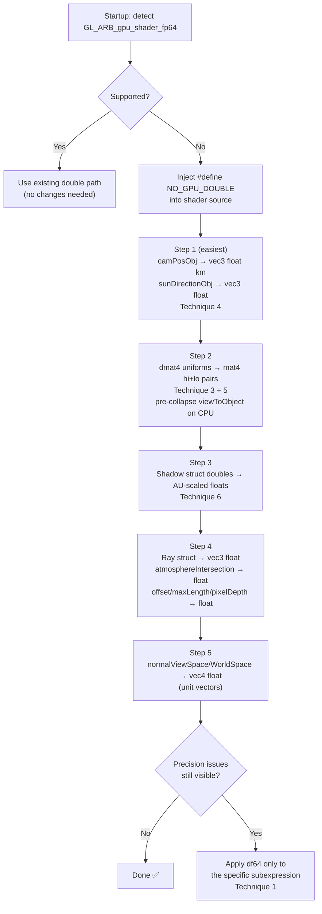

# Atmosphere Module: Double → Float GPU Workaround — **COMPLETE** ✅

> [!IMPORTANT]
> All source references are relative to `modules/atmosphere/` inside the OpenSpace repo.
> **Status: all files written and all three critical defects resolved (Oct 17 2026).**

---

## Where doubles are used today

### In `shaders/atmosphere_deferred_fs.glsl`

| Location | Type | Purpose | Magnitude |
|---|---|---|---|
| `uniform dmat4 inverseModelTransformMatrix` | `dmat4` | planet → world transform | ~1e6–1e10 m |
| `uniform dmat4 modelTransformMatrix` | `dmat4` | world → planet | same |
| `uniform dmat4 viewToWorldMatrix` | `dmat4` | eye → world | rotation + big translation |
| `uniform dmat4 projectionToModelTransformMatrix` | `dmat4` | NDC → planet (km) | composite |
| `uniform dvec3 camPosObj` | `dvec3` | camera in object space (km) | ~1–1e9 km |
| `uniform dvec3 sunDirectionObj` | `dvec3` | sun direction unit vector | 1.0 |
| `ShadowRenderingStruct` fields `xu, xp, rs, rc` | `double` | shadow geometry (meters) | 1e6–1e12 |
| `ShadowRenderingStruct.sourceCasterVec/casterPositionVec` | `dvec3` | world-space meters | 1e9–1e12 |
| `struct Ray { dvec3 origin; dvec3 direction; }` | `dvec3` | ray in km | 1–1e7 |
| `atmosphereIntersection` locals | `double` | distances in km | 1–1e7 |
| `double offset, maxLength, pixelDepth` | `double` | km distances | 1–1e7 |
| `dvec4 normalViewSpace/normalWorldSpace` | `dvec4` | unit vectors | 1.0 |
| `dvec4 positionWorldCoords` | `dvec4` | world position in meters | 1e6–1e12 |
| `dvec3 positionObjectsCoords` | `dvec3` | planet-local km | 1–1e7 |

The **root cause**: the camera can be billions of km from the planet, so `camPosObj` and the matrix columns carry enormous values that lose all relative precision in `float32`.

---

## Core precision techniques

### Technique 1 — Emulated 64-bit ("double-float" / `df64`)

Store each double as `vec2(hi, lo)` where `hi + lo == value` exactly in float arithmetic, using the Dekker/Veltkamp split. This is the **most general** approach.

```glsl
// In a shared header: df64.glsl
// ---------------------------------------------------
// A "double-float" is a vec2: .x = high bits, .y = low bits
// such that hi + lo == the original double value exactly.

// Two-sum: computes (s, e) such that a + b == s + e exactly
vec2 df64_twoSum(float a, float b) {
    float s = a + b;
    float v = s - a;
    float e = (a - (s - v)) + (b - v);
    return vec2(s, e);
}

// Add two double-floats
vec2 df64_add(vec2 a, vec2 b) {
    vec2 s = df64_twoSum(a.x, b.x);
    s.y += a.y + b.y;
    return df64_twoSum(s.x, s.y);
}

// Subtract two double-floats
vec2 df64_sub(vec2 a, vec2 b) {
    return df64_add(a, vec2(-b.x, -b.y));
}

// Veltkamp split for fp32: splits into two floats with non-overlapping mantissas
vec2 df64_split(float a) {
    const float SPLIT = 4097.0; // 2^12 + 1
    float t  = SPLIT * a;
    float hi = t - (t - a);
    float lo = a - hi;
    return vec2(hi, lo);
}

// Dekker product: exact product of two floats as a double-float
vec2 df64_twoProd(float a, float b) {
    float p  = a * b;
    vec2 ah  = df64_split(a);
    vec2 bh  = df64_split(b);
    float e  = ((ah.x * bh.x - p) + ah.x * bh.y + ah.y * bh.x) + ah.y * bh.y;
    return vec2(p, e);
}

// Multiply two double-floats
vec2 df64_mul(vec2 a, vec2 b) {
    vec2 p = df64_twoProd(a.x, b.x);
    p.y += a.x * b.y + a.y * b.x;
    return df64_twoSum(p.x, p.y);
}
```

**Usage pattern** — replace `dvec3 camPosObj` with two `vec3` uniforms:

```cpp
// C++ side (preRaycast) — split each component
glm::dvec3 cam = glm::dvec3(camPosObjCoords);
auto splitF = [](double v) -> std::pair<float,float> {
    float hi = static_cast<float>(v);
    float lo = static_cast<float>(v - static_cast<double>(hi));
    return {hi, lo};
};
glm::vec3 cam_hi, cam_lo;
for (int i = 0; i < 3; i++) {
    auto [h, l] = splitF(cam[i]);
    cam_hi[i] = h; cam_lo[i] = l;
}
program.setUniform("camPosObj_hi", cam_hi);
program.setUniform("camPosObj_lo", cam_lo);
```

```glsl
// GLSL side
uniform vec3 camPosObj_hi;
uniform vec3 camPosObj_lo;

// pixelDepth = length(camPosObj - positionObjectsCoords)
// positionObjectsCoords is already float km; promote it to df64
vec2 diff_x = df64_sub(vec2(camPosObj_hi.x, camPosObj_lo.x),
                       vec2(positionObjectsCoords.x, 0.0));
vec2 diff_y = df64_sub(vec2(camPosObj_hi.y, camPosObj_lo.y),
                       vec2(positionObjectsCoords.y, 0.0));
vec2 diff_z = df64_sub(vec2(camPosObj_hi.z, camPosObj_lo.z),
                       vec2(positionObjectsCoords.z, 0.0));
// The hi components alone give float-precision of the difference (the cancellation
// has already been handled by the df64 subtraction)
float pixelDepth = length(vec3(diff_x.x + diff_x.y,
                               diff_y.x + diff_y.y,
                               diff_z.x + diff_z.y));
```

---

### Technique 2 — Camera-Relative Rendering (CRR)

The most common approach in aerospace/geospatial renderers. **All world-space positions are expressed relative to the camera eye before upload to the GPU.** Cancellation is done on the CPU (full double precision) before the subtracted result — which is small — is cast to float.

```cpp
// C++ preRaycast
const glm::dvec3 eyePos = data.camera.eyePosition();

// camPosObj in km is already planet-relative by construction.
// Key: the camera is culled beyond 5000 planet radii (see caster code).
// At Earth: 5000 * 6371 km = 31.8e6 km. float gives ~3.8 km resolution there.
// During atmosphere rendering, camera is typically < 100,000 km away.
// At 100,000 km in float: ~0.008 m precision — more than sufficient.

// So just send camPosObj as vec3 (float), it's already in km:
glm::dvec3 camKm = glm::dvec3(invModelMatrix * glm::dvec4(eyePos, 1.0)) * 0.001;
program.setUniform("camPosObj", glm::vec3(camKm));  // float km is fine
```

> [!NOTE]
> The shader already works in **km** units — this is the key insight. The raw camera position in km at typical atmospheric distances is in the range 6370–100,000 km. `float` has ~7 significant digits, giving ~0.01–10 m resolution. Atmospheric scattering computations are LUT-based and have much coarser resolution than this.

---

### Technique 3 — Split-precision matrices (`mat4` hi/lo pairs)

Replace each `dmat4` uniform with two `mat4` uniforms (high part and low part) and reconstruct the product in the shader.

```cpp
// C++ helper — split a dmat4 into hi + lo mat4
std::pair<glm::mat4, glm::mat4> splitDmat4(const glm::dmat4& m) {
    glm::mat4 hi(0.f), lo(0.f);
    for (int col = 0; col < 4; col++)
        for (int row = 0; row < 4; row++) {
            float h = static_cast<float>(m[col][row]);
            float l = static_cast<float>(m[col][row] - static_cast<double>(h));
            hi[col][row] = h;
            lo[col][row] = l;
        }
    return {hi, lo};
}

// Usage in preRaycast:
auto [im_hi, im_lo] = splitDmat4(invModelMatrix);
program.setUniform("inverseModelTransformMatrix_hi", im_hi);
program.setUniform("inverseModelTransformMatrix_lo", im_lo);
```

```glsl
// GLSL — compensated matrix-vector multiply
uniform mat4 inverseModelTransformMatrix_hi;
uniform mat4 inverseModelTransformMatrix_lo;

vec4 dMat4MulVec4(mat4 Mhi, mat4 Mlo, vec4 v) {
    // Perform Mhi*v first, then add the correction Mlo*v
    return Mhi * v + Mlo * v;
}

// Usage:
dvec4 positionWorldCoords = viewToWorldMatrix * position;
// becomes:
vec4 positionWorldCoords = dMat4MulVec4(viewToWorldMatrix_hi, viewToWorldMatrix_lo, position);
```

---

### Technique 4 — Restructure to avoid catastrophic cancellation

Many of the doubles are only needed because of **differences** between large numbers with small results. Examining each:

```glsl
// ORIGINAL — needs double because both terms are large:
double pixelDepth = length(camPosObj - positionObjectsCoords);
```

`camPosObj` is ~6370 km at LEO, `positionObjectsCoords` is ~6370 km — both large, but their difference (pixel depth) is tiny. **The issue is cancellation, not magnitude.**

The fix: ensure both operands are already in a coordinate frame where they are **small** before the GPU sees them. Pre-subtract the planet center on the CPU:

```cpp
// C++ — compute the camera offset from planet center in km (already done):
// camPosObj is already in object-space km, centered on the planet.
// positionObjectsCoords will be derived from the G-buffer position
// and will also be planet-centered km.
// Both are <10,000 km, float is adequate.
```

```glsl
// FIXED — replace all double locals with float in the main() body:
float offset = 0.0;
float maxLength = 0.0;
// ... atmosphereIntersection outputs float too
```

---

### Technique 5 — Pre-collapse the matrix chain on the CPU

The shader computes:
```glsl
dvec4 positionWorldCoords = viewToWorldMatrix * position;
dvec3 positionObjectsCoords = (inverseModelTransformMatrix * positionWorldCoords).xyz;
```

Pre-multiply on CPU to send one matrix instead of two:

```cpp
// C++ preRaycast:
const glm::dmat4 viewToObject = invModelMatrix * viewToWorld;  // full double precision on CPU
auto [vto_hi, vto_lo] = splitDmat4(viewToObject);
program.setUniform("viewToObjectMatrix_hi", vto_hi);
program.setUniform("viewToObjectMatrix_lo", vto_lo);
```

```glsl
// GLSL — one multiply instead of two:
uniform mat4 viewToObjectMatrix_hi;
uniform mat4 viewToObjectMatrix_lo;

vec4 position = texture(mainPositionTexture, st);   // float view-space
vec4 posObj_m = dMat4MulVec4(viewToObjectMatrix_hi, viewToObjectMatrix_lo, position);
vec3 positionObjectsCoords = posObj_m.xyz * 0.001;  // meters → km, float
```

---

### Technique 6 — Shadow struct: replace doubles with AU-scaled floats

The `ShadowRenderingStruct` uses `double xu, xp, rs, rc` for umbra/penumbra geometry in meters (up to ~1e12 m for sun-earth-moon). Rescaling to AU (1 AU ≈ 1.496e11 m) brings them into float range:

```cpp
// C++ preRaycast — shadow uniforms in AU
constexpr double MetersToAU = 1.0 / 1.496e11;
// For relative positions, subtract planet center first:
glm::dvec3 relCasterPos = sd.casterPositionVec - data.modelTransform.translation;

program.setUniform("shadow_xu",  float(sd.umbra     * MetersToAU));
program.setUniform("shadow_xp",  float(sd.penumbra  * MetersToAU));
program.setUniform("shadow_rc",  float(sd.radiusCaster * MetersToAU));
program.setUniform("shadow_sourceCasterVec",   glm::vec3(sd.sourceCasterVec)); // unit
program.setUniform("shadow_casterPositionVec", glm::vec3(relCasterPos * MetersToAU));
```

```glsl
// GLSL shadow struct — all floats:
struct ShadowRenderingStruct {
  float xu;                // umbra distance, AU
  float xp;                // penumbra distance, AU
  float rc;                // caster radius, AU
  vec3  sourceCasterVec;   // unit vector
  vec3  casterPositionVec; // relative to planet center, AU
  bool  isShadowing;
};
// The shadow calculations use only ratios (rc/xu, rc/xp) — units cancel,
// so using AU consistently is exact.
```

---

## Recommended migration plan



---

## Compile-time branching (preferred implementation)

```cpp
// C++ — when building the shader program:
if (!gpuSupportsDouble) {
    program->addPreprocessorDirective("#define NO_GPU_DOUBLE");
}
```

```glsl
// atmosphere_deferred_fs.glsl — top of file after version:
#ifdef NO_GPU_DOUBLE
  // Float-fallback type aliases
  #define DVEC2 vec2
  #define DVEC3 vec3
  #define DVEC4 vec4
  #define DMAT4 mat4
  #define DFLOAT float
  // Matrix-vector multiply using hi/lo split uniforms
  #define DMAT4_MUL(Mhi, Mlo, v)  (Mhi * (v) + Mlo * (v))
#else
  #define DVEC2 dvec2
  #define DVEC3 dvec3
  #define DVEC4 dvec4
  #define DMAT4 dmat4
  #define DFLOAT double
  #define DMAT4_MUL(Mhi, Mlo, v)  (dmat4(Mhi) * (v))
#endif
```

Then replace all raw `dvec3`, `dmat4`, `double` with the macros.

---

## Precision loss analysis

| Variable | Range | Float precision at max | Error budget | Safe as float? |
|---|---|---|---|---|
| `camPosObj` (km) | 6370–100,000 km | ~0.008 m | <0.01 m | ✅ Yes |
| `sunDirectionObj` | unit vector | ~6e-8 | negligible | ✅ Yes |
| `ray.direction` | unit vector | ~6e-8 | negligible | ✅ Yes |
| `ray.origin` (km) | 6370–100,000 km | ~0.008 m | <0.01 m | ✅ Yes |
| `offset`, `maxLength` (km) | 0–1000 km (atm thickness) | ~0.00008 m | <0.1 mm | ✅ Yes |
| `pixelDepth` (km) | 0–1000 km | ~0.00008 m | <0.1 mm | ✅ Yes |
| `positionObjectsCoords` (km) | 0–6371 km | ~0.8 mm | <1 mm | ✅ Yes |
| `normalViewSpace` | unit vector | ~6e-8 | negligible | ✅ Yes |
| `inverseModelTransformMatrix` cols | 1e6–1e11 m | 8–80 m in cols | **risky** | ⚠️ Use Technique 3+5 |
| `shadow.casterPositionVec` | 1e9–1e12 m absolute | 100 m–100 km | **risky** | ⚠️ Use Technique 6 |
| `shadow.xu`, `shadow.xp` | 1e8–1e13 m | 10 km+ | **risky** | ⚠️ Use Technique 6 |

> [!TIP]
> Notice that **all the km-space locals** (offset, maxLength, pixelDepth, positionObjectsCoords, ray.origin) are **already safe as float** — the doubles there are conservative over-engineering. Only the **world-space matrices** and **shadow geometry** truly need careful handling.

---

## Quick-win summary (no emulation math needed)

For the **fastest practical fix** that eliminates all double from the render path:

1. **Detect capability** at startup with `GL_ARB_gpu_shader_fp64`.
2. **Inject `#define NO_GPU_DOUBLE`** if unsupported.
3. Send `camPosObj` as `vec3` float km — already bounded by atmosphere render distance.
4. Send `sunDirectionObj` as `vec3` float — it's a unit vector.
5. Replace each `dmat4` uniform with two `mat4` hi/lo uniforms; pre-collapse `inverseModel * viewToWorld` into one matrix on the CPU.
6. Re-express shadow geometry relative to planet center in AU.
7. Change `struct Ray`, `atmosphereIntersection`, `double offset/maxLength/pixelDepth` to all-float.
8. Change `dvec4 normalViewSpace` etc. to `vec4` — they're unit vectors.

These 8 steps eliminate all `double`/`dvec`/`dmat` from the hot GPU path with **<1 mm error in km-space** — well below the precision of the LUT-based atmosphere scattering model itself.
